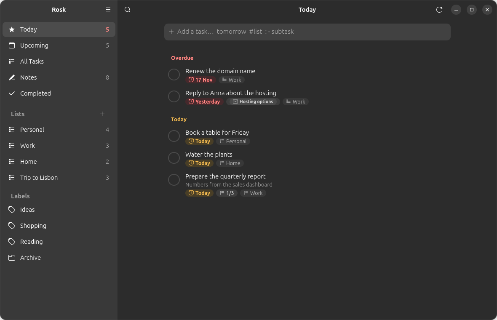
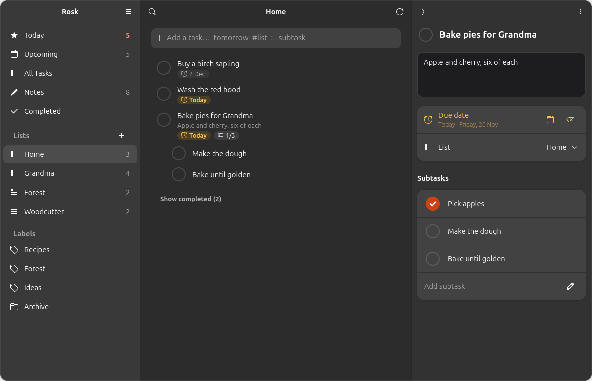
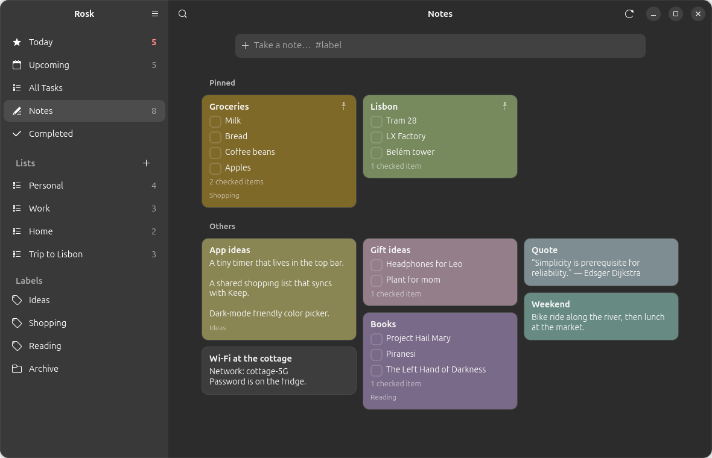
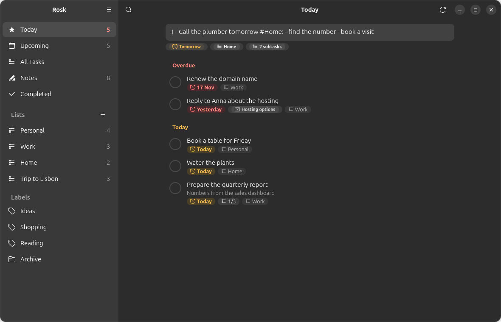
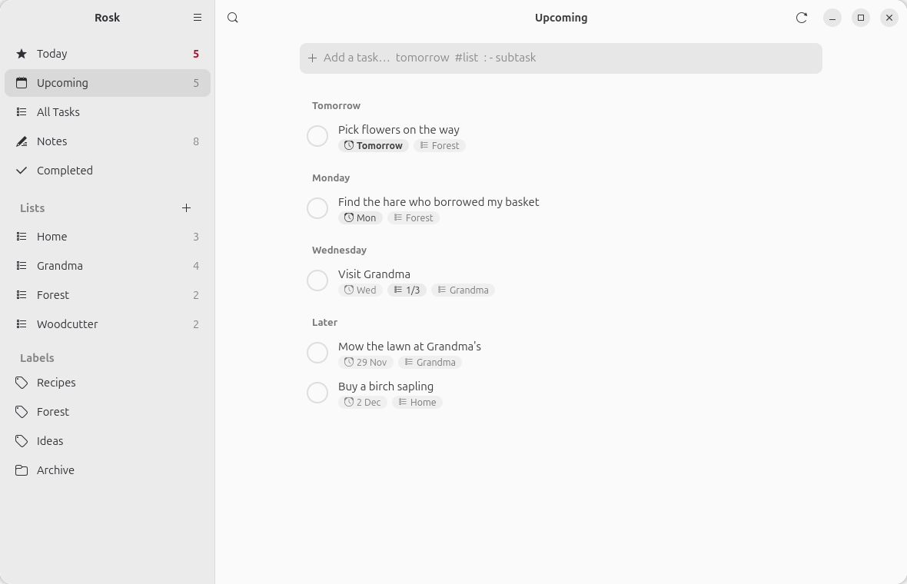
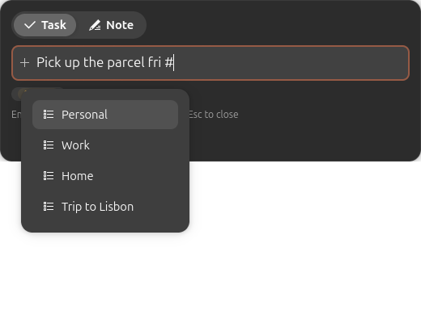
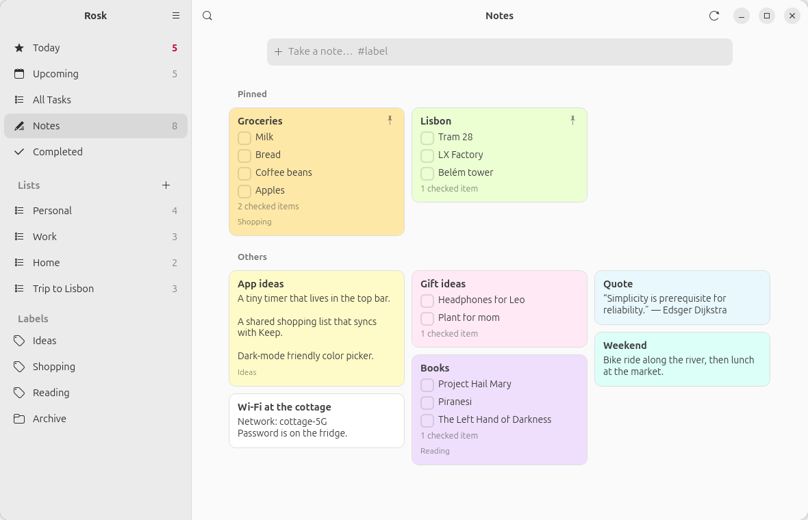
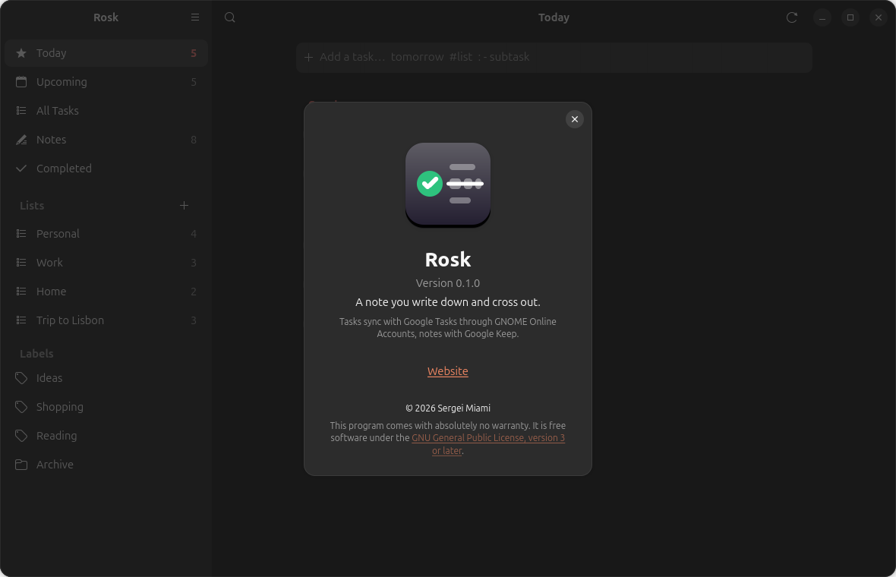

# Rosk

[English](README.md) · **Русский**

Rosk — это заметка, которую написал и вычеркнул. Менеджер задач и заметок для рабочего стола
GNOME, главное в нём — скорость и краткость: записать мысль — пара секунд, вычеркнуть — ещё
быстрее.

> Статус: первая рабочая версия (0.1). Задачи синхронизируются с Google Tasks; для Keep нужно один раз войти в настройках.



## Что умеет

- **Быстрый ввод из верхней панели.** Rosk добавляет значок в панель GNOME. Клик или горячая
  клавиша, одна строка вроде `Позвонить в банк завтра #работа`, Enter — готово.
- **Задачи и заметки Google в одном месте.** Задачи синхронизируются с Google Tasks, заметки —
  с Google Keep. В Rosk они рядом, но в Google не смешиваются: задачи остаются в Tasks, заметки —
  в Keep.
- **Работает без сети.** Все изменения сохраняются локально сразу и уходят в Google, когда связь
  появится.
- **Всё на виду.** Все списки в одном окне, подзадачи и сроки. То, что пора делать сегодня или уже
  просрочено, подсвечивается.
- **Минимализм и родной вид GNOME.** GTK 4 и libadwaita, светлая и тёмная тема, полное управление
  с клавиатуры.

## Скриншоты

| | |
|---|---|
|  |  |
| Списки, подзадачи и панель редактирования | Заметки Google Keep: закреплённые и цветные |
|  |  |
| Одна строка: дата, список и подзадачи распознаются на лету | Предстоящие задачи по дням, светлая тема |
|  |  |
| Быстрый ввод: задача или заметка, после `#` подсказываются списки | Заметки в светлой теме |
|  | |
| Окно «О программе» | |

На скриншотах выдуманные данные; пересоздать их можно скриптом `tools/screenshots.py`.

## Требования

GNOME 48 или новее, аккаунт Google в «Настройки → Сетевые учётные записи» и пакеты (в Ubuntu
26.04 уже стоят):

```sh
sudo apt install python3-gi python3-venv gir1.2-gtk-4.0 gir1.2-adw-1 gir1.2-goa-1.0 gir1.2-secret-1
# для окна входа в Google Keep:
sudo apt install gir1.2-webkit-6.0
```

## Установка

```sh
make install      # в ~/.local, root не нужен
make uninstall    # удаляет приложение, данные остаются в ~/.local/share/rosk
make status       # работает ли, что на сегодня, активно ли расширение панели
```

После установки Rosk работает в фоне, его значок появляется в верхней панели, а сам он
запускается вместе с сеансом. На Wayland GNOME загружает новые расширения Shell только при
входе, поэтому до перезахода в сеанс Rosk показывает компактный значок через AppIndicator.

## Как пользоваться

- **Super+Alt+R** или клик по значку в панели: одна строка, Enter. Shift+Enter оставляет поле
  открытым для следующей задачи.
- Синтаксис: `завтра`, `в пт`, `12.12`, `через 3 дня` (английский тоже: `tomorrow`, `fri`),
  `#список`, `n:` в начале — заметка, `Поездка: - билеты - отель` — подзадачи или пункты списка.
- Поиск задач и заметок прямо из обзора GNOME.
- Google Keep: Настройки → Google Keep → Войти через Google. Для личных аккаунтов у Google нет публичного API Keep,
  поэтому Rosk использует неофициальную библиотеку [gkeepapi](https://github.com/kiwiz/gkeepapi).

## Команды make

Полный список: `make`.

| Команда | Что делает |
|---|---|
| **Установка и служба** | |
| `make install` | Установка в `~/.local`: приложение, фоновая служба, расширение панели, поиск, автозапуск. Повторный запуск обновляет |
| `make uninstall` | Удаляет установку; данные в `~/.local/share/rosk` остаются |
| `make status` | Работает ли служба, что на сегодня, активно ли расширение панели |
| `make sync` | Синхронизировать с Google сейчас |
| `make restart` / `start` / `quit` | Перезапустить, запустить или остановить установленную службу |
| `make logs` | Последние строки журнала службы и расширения |
| **Разработка** | |
| `make venv` | Создать `.venv` поверх системного PyGObject, с gkeepapi, pytest и ruff |
| `make run` | Запустить из исходников рядом с установленным Rosk, со своими данными в `build/dev-data` (синхронизируется с Google) |
| `make run-offline` | То же без синхронизации и значка в панели — чтобы спокойно пробовать |
| `make test` | Тесты |
| `make lint` | Проверка Python-кода через ruff |
| `make check` | Всё перед коммитом: линтер, тесты, синтаксис расширения, схема настроек, переводы |
| `make pot` | Обновить `po/rosk.pot` по коду и влить в переводы |
| `make locale` | Скомпилировать переводы |
| `make screenshots` | Пересоздать скриншоты README из выдуманных демо-данных |
| **Выпуск** | |
| `make dist` | Архив исходников `dist/rosk-<версия>.tar.gz` |
| `make clean` | Удалить `build/`, `dist/` и кэши (не ваши данные) |

## Лицензия

Rosk — свободная программа под лицензией [GNU GPL версии 3 или новее](LICENSE).

## Документация

- [Спецификация](docs/SPEC.md)
- [Архитектура](docs/ARCHITECTURE.md)
- [Возможности и ограничения API Google](docs/GOOGLE_APIS.md)
- [Решения](docs/DECISIONS.md)
- [План разработки](docs/ROADMAP.md)
